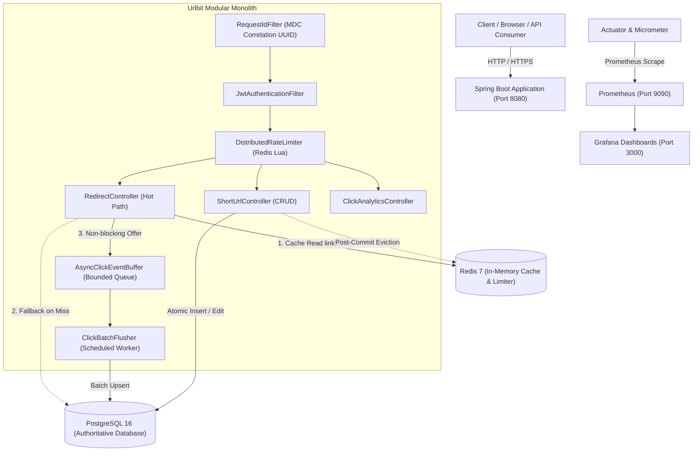
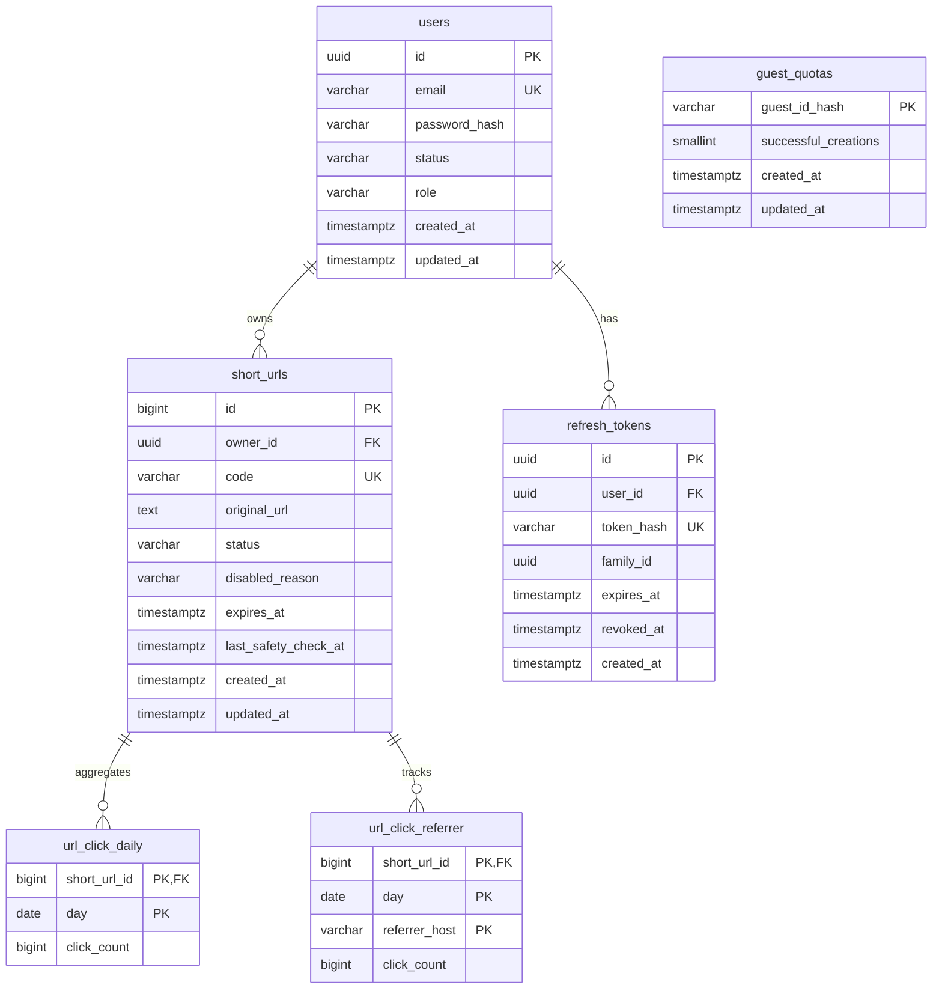

# Urlbit — High-Throughput URL Shortener & Link Analytics SaaS

[](https://openjdk.org/projects/jdk/21/)
[](https://spring.io/projects/spring-boot)
[](https://www.postgresql.org/)
[](https://redis.io/)
[](https://prometheus.io/)
[](https://grafana.com/)
[]()
[](LICENSE)

Urlbit is a production-grade, modular-monolith URL shortening and real-time link analytics service engineered for extreme concurrency, deterministic reliability, and transparent performance benchmarking.

---

## 1. System Architecture

Urlbit separates high-throughput **redirect hot paths** from heavy **write operations**, protecting the relational database with multi-layer caching, non-blocking in-memory event buffers, and atomic distributed rate limiters.



---

## 2. Key Architectural Highlights & Non-Obvious Decisions

| Problem | Naive Approach | Urlbit Production Architecture | Why It Matters |
|---|---|---|---|
| **Code Generation** | Sequential DB auto-increment (`id -> Base62`) | **7-char Cryptographically Random Base62** (`SecureRandom`, $3.52\times 10^{12}$ combinations) | Prevents link scraping, competitor business volume enumeration, and distributed sequence bottlenecks ([ADR 001](docs/adr/ADR-001-code-generation-base62.md)). |
| **Hot-Row Lock Contention** | `UPDATE short_urls SET clicks = clicks + 1` on redirect | **Bounded In-Memory Queue + Scheduled Batch Upserts** (`OVERFLOW_DROP`) | Serializing 2,000 clicks/sec on a single row lock crashes PostgreSQL. In-memory buffering keeps redirects < 10ms ([ADR 004](docs/adr/ADR-004-async-click-analytics.md)). |
| **Multi-Instance Rate Limiting** | Naive Redis `GET -> INCR` or JVM in-memory counters | **Atomic Redis Lua Script** executing sliding-window sorted sets (`ZADD`, `ZREMRANGEBYSCORE`) | Prevents concurrency race conditions across multi-instance deployments and stops boundary-burst attacks ([ADR 003](docs/adr/ADR-003-distributed-rate-limiting.md)). |
| **Cache Consistency & Takedowns** | Invalidate cache before DB commit | **Post-Commit Eviction + Fail-Open Fallback** | Evicting before commit causes stale cache resurrection from concurrent uncommitted reads ([ADR 002](docs/adr/ADR-002-cache-aside-redis.md)). |
| **Guest Quota Abuse** | IP-only or non-atomic DB `SELECT then INSERT` | **Atomic PostgreSQL `RETURNING` + 30-Day Fixed Cookie + IP `/64` Masking** | Concurrent requests cannot bypass the 5-link limit. Cookie Max-Age is never refreshed ([ADR 005](docs/adr/ADR-005-guest-quotas-and-abuse.md)). |

---

## 3. Database Schema & Data Model

The schema is managed strictly via **Flyway migrations** (`db/migration/`). Never uses Hibernate `ddl-auto=update`.



---

## 4. Quickstart Guide

### Option A: Turnkey Production Deployment (Recommended)
Spins up PostgreSQL, Redis, containerized Spring Boot backend, Prometheus, and Grafana in one command:

```bash
# Clone the repository
git clone https://github.com/vaibhavdwivedi27/UrlBit.git
cd Urlbit

# Start full turnkey stack
docker compose -f infra/compose.prod.yml up -d --build
```
- **Backend API:** `http://localhost:8080`
- **Swagger UI:** `http://localhost:8080/swagger-ui.html`
- **Grafana Dashboards:** `http://localhost:3000` (User: `admin` / Password: `admin`)
- **Prometheus Scraper:** `http://localhost:9090`

---

### Option B: Local Developer Mode
Run supporting infrastructure in Docker, build and run Spring Boot locally on your host machine:

```bash
# 1. Start backing stores & monitoring
docker compose -f infra/compose.local.yml --profile monitoring up -d

# 2. Build and run backend locally (Java 21 required)
cd backend
./mvnw spring-boot:run
```

---

## 5. Verification & Test Suite

The project includes an exhaustive automated test suite with **117 tests** (69 unit tests + 48 integration tests). Integration tests run against real **PostgreSQL 16 and Redis 7 Testcontainers** (singleton containers shared across test classes for fast execution).

```bash
# Run all unit tests (69 tests)
./mvnw test

# Run full integration test suite with Testcontainers (48 tests)
./mvnw verify

# Run Spotless code formatting verification (Google Java AOSP style)
./mvnw spotless:check

# Auto-apply code formatting
./mvnw spotless:apply
```

### Verified Test Matrix
- **Unit Tests:** Base62 entropy/uniqueness, reserved word case-insensitivity, destination safety normalization (punycode, IDN, IP literals, blocklist), sliding-window math, JWT token lifecycle.
- **Concurrency Tests:** Parallel custom alias creation (10 threads racing on identical code $\rightarrow$ exactly 1 winner, 9 conflict errors), forced code collision retry (preserves guest quota).
- **Security Tests:** IDOR link access controls, refresh token reuse detection and family revocation, cookie CSRF protection, guest quota boundary checks.
- **Resilience / Chaos Tests:** Complete Redis container pause (graceful fail-open DB fallback), in-memory queue 100% saturation (redirects succeed with 302, drop counter increments).

---

## 6. Performance Engineering & Benchmarks (`load-tests/`)

Urlbit includes a complete **[k6](https://k6.io/) load testing suite** under [`load-tests/`](load-tests/):

### Pre-populate Seed Data (100 Hot Links & 10,000 Cold Links)
```bash
# On Linux / macOS / Git Bash:
./load-tests/seed/seed.sh

# On Windows:
.\load-tests\seed\seed.bat
```

### Zero-Install Benchmark Execution via Docker
You don't need k6 installed locally; run scenarios via the official container:

```bash
# 1. Smoke Test (5 VUs, 15 seconds)
./load-tests/run-k6.sh smoke.js

# 2. Baseline Test (100 RPS sustained for 5 minutes)
./load-tests/run-k6.sh baseline.js

# 3. Stepped Ramp-Up (100 -> 500 -> 1,000 -> 2,000 RPS)
./load-tests/run-k6.sh ramp.js

# 4. Viral Hot-Cache Test (1,000 RPS against top 20 links)
./load-tests/run-k6.sh hot-cache.js

# 5. Cold-Cache Miss Test (200 RPS across 10,000 links)
./load-tests/run-k6.sh cold-cache.js

# 6. URL Creation Write Test (50 creates/sec)
./load-tests/run-k6.sh create-api.js
```

Detailed benchmarking guide, target SLAs, failure drills, and execution report templates are documented in the **[Load Test Plan](load-tests/LOAD_TEST_PLAN.md)** and [`docs/benchmarks/README.md`](docs/benchmarks/README.md).

---

## 7. API Reference & Postman

- **Exhaustive API Reference:** [`docs/API.md`](docs/API.md) (Headers, request/response bodies, RFC 9457 error contracts, curl examples).
- **Postman Collection & Environment:** [`docs/postman/`](docs/postman/) (Ready-to-import JSON collection with automated environment variables and test scripts).

### Core Endpoints
- `GET /{code}` — Public redirect (HTTP 302 / 404).
- `POST /api/v1/auth/signup` — User registration.
- `POST /api/v1/auth/login` — Authentication & cookie issuance.
- `POST /api/v1/urls` — Short URL creation (guest quota = 5; authenticated = custom alias & expiry).
- `GET /api/v1/urls` — Paginated owner link listing.
- `GET /api/v1/analytics/urls/{id}` — Aggregated daily clicks & top referrers.
- `GET /actuator/health/readiness` — Health probe checking DB & Redis.
- `GET /actuator/prometheus` — Prometheus metrics scraping endpoint.

---

## 8. Architecture Decision Records (ADRs)

Key architectural tradeoffs and rejected alternatives are documented in [`docs/adr/`](docs/adr/):

1. **[ADR 001: Random Base62 Codes vs. Sequential IDs](docs/adr/ADR-001-code-generation-base62.md)**
2. **[ADR 002: Cache-Aside Consistency & Redis Invalidation](docs/adr/ADR-002-cache-aside-redis.md)**
3. **[ADR 003: Distributed Rate Limiting via Atomic Lua Scripts](docs/adr/ADR-003-distributed-rate-limiting.md)**
4. **[ADR 004: Asynchronous Click Analytics Buffering](docs/adr/ADR-004-async-click-analytics.md)**
5. **[ADR 005: Transactional Guest Quotas & Abuse Defenses](docs/adr/ADR-005-guest-quotas-and-abuse.md)**

---

## License

Urlbit is licensed under the Apache 2.0 License.
