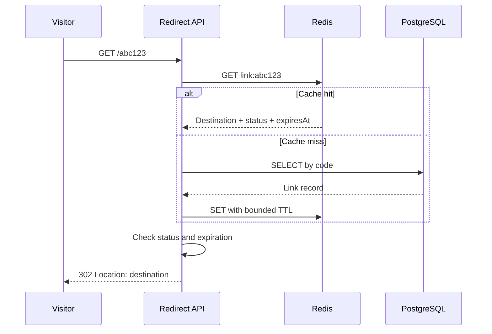

# Urlbit — Product & Engineering Specification

**Version:** 1.4 | **Status:** Proposed baseline | **Product:** Urlbit — URL shortening and link analytics SaaS | **Primary domain:** `urlbit.in`

> This is the source of truth for *what* to build. See [`AGENTS.md`](AGENTS.md) for *how AI coding agents must implement it*. Decisions not explicitly finalized are tagged **Decision needed**. Performance numbers are goals, never claimed results.

## Brand identity and positioning

| Element | Specification |
|---|---|
| **Brand name** | **Urlbit** |
| **Primary domain** | **`urlbit.in`** (planned; domain ownership/DNS configuration to be verified before launch) |
| **Tagline** | **Shorten. Track. Grow.** |
| **SEO homepage title** | **Urlbit — Free URL Shortener & Link Analytics** |
| **Example short URL** | **`https://urlbit.in/abc123`** |
| **Positioning** | Simple URL shortening today, expandable into link analytics, custom domains, developer APIs, and AI-powered insights |

**Brand experience:** Use “Urlbit” consistently in the logo, navigation, page titles, email templates, documentation, screenshots, API examples, and product copy. The homepage should prominently show the tagline **Shorten. Track. Grow.** and explain the short-link creation and tracking value proposition. The SEO title above is target metadata; do not claim “Free” for capabilities that are not actually available without payment. No particular domain registration or ownership is asserted by this document.

**Growth roadmap:**
- **MVP:** URL shortening, link management, expiration, authenticated dashboard; basic click counts optional (see §12).
- **Phase B:** Richer link analytics, charts, reliable event collection, performance and abuse controls.
- **Phase C:** Verified custom domains, documented developer APIs/API keys, usage tiers and collaboration.
- **Future exploration:** AI insights (e.g. explain link trends, surface unusual traffic, suggest campaign improvements), only after sufficient trustworthy analytics data and explicit privacy/security review.

**Routing requirement:** Public short links use `https://urlbit.in/{code}`. The same host may also serve the marketing website and dashboard, so reserved routes (`/`, `/login`, `/signup`, `/dashboard/*`, `/api/*`, etc.) must take precedence over short-code resolution. Evaluate `app.urlbit.in` for the dashboard if simpler separation is needed, while preserving `urlbit.in/{code}` as the public short-link format.

## 1. Product vision

Build a secure, reliable, observable, performance-tested URL shortener that lets individuals and developers create, manage, and measure short links. Its engineering portfolio value comes from demonstrating Java/Spring Boot API design, PostgreSQL data integrity, Redis caching, distributed rate limiting, asynchronous analytics, production operations, and reproducible load tests—not from the complexity of a URL-shortening endpoint alone.

### Target audiences
- **Individual creator:** Create links, set aliases/expiration, see clicks.
- **Developer:** Integrate through documented REST APIs; API keys are post-MVP.
- **Portfolio reviewer:** Run the stack locally, inspect tests and architecture, reproduce benchmarks.

### Success criteria
1. Correct redirects, ownership enforcement, and expiration under concurrency.
2. A useful, accessible UI and documented public API.
3. Automated tests and one-command local setup.
4. Measured performance with clear hardware/workload disclosure.
5. A safe public demo and transparent operational limitations.

### Non-goals for MVP
Payments, billing, teams, QR generation, custom domains, multi-region, multi-tenant enterprise controls, geo-IP tracking, elaborate ML fraud detection, microservice decomposition.

## 2. Scope and priorities

| Feature | Phase A — MVP | Phase B — Hardening | Phase C — SaaS |
|---|---|---|---|
| Sign up / login / logout | Required | Security review | SSO optional |
| Create and resolve short URLs | Required | Optimize | Custom domains |
| Random/custom aliases | Required | Abuse protection | Reserved aliases |
| Link expiration, disable, delete | Required | Cache correctness | Scheduled policies |
| User dashboard and link list | Required | Pagination/UX polish | Team workspaces |
| Basic click totals | Optional, never a synchronous DB write on redirect (§12) | Async daily aggregates, charts | Advanced segmentation |
| PostgreSQL | Required | Index tuning | Read replicas |
| Redis | Optional local integration | Required cache/rate limit | Cluster strategy |
| Load testing | Smoke benchmark | Required reproducible suite | Scale experiments |
| Public API keys / quotas | No | Optional groundwork | Required |
| Billing / subscriptions | No | No | Optional after demand |

**Backend-first delivery order:** backend bootstrap → core URL APIs and concurrency → authentication/ownership → Redis cache → distributed rate limiting → asynchronous analytics → observability/tests → benchmarks/optimization → backend deployment → React UI → SaaS expansion. Each step requires a verified acceptance gate. The React UI remains in scope, but is deliberately scheduled after the backend portfolio release.

## 3. Technology decisions

| Layer | Preferred choice | Rationale |
|---|---|---|
| Backend | Java 21, Spring Boot 3.x compatible release | Mature ecosystem; strong backend interview signal |
| Build | Maven with committed Maven Wrapper (`./mvnw`); Surefire for unit tests, Failsafe for integration tests | Standard Spring Boot tooling; one build tool only |
| API | Spring Web, Bean Validation, OpenAPI/Swagger | Contract-driven REST |
| Security | Spring Security; JWT access tokens + rotating opaque refresh tokens; Secure HttpOnly cookie for browser tokens | Reduce token exposure; CSRF protection for cookie auth |
| Persistence | Spring Data JPA + PostgreSQL | Relational integrity and indexed lookups |
| Migrations | Flyway | Versioned schema |
| Cache | Redis, Spring Data Redis | Fast code lookup and distributed coordination |
| Frontend | React + TypeScript + Vite + Tailwind CSS | Lightweight SPA |
| Analytics charts | Recharts | Simple time series |
| Tests | JUnit 5, Mockito, Spring Boot Test, Testcontainers, Playwright optional | Unit/integration/E2E coverage |
| Observability | Actuator, Micrometer, Prometheus, Grafana, structured logs | Inspect throughput and latency |
| Load | k6 | Reproducible performance experiments |
| Delivery | Docker Compose, GitHub Actions | Consistent developer setup and CI |

**Decision needed:** Confirm ownership and DNS setup of `urlbit.in`, finalize whether dashboard uses `urlbit.in` or `app.urlbit.in`, hosted auth model, cloud provider and hosting budget. Pin exact library versions at project initialization and record them in the README.

## 4. User journeys and UI

### Pages
1. **Landing (`/`)**: headline, value proposition, create-account CTA, link to login; guest shortening available without signup, with five lifetime successful creations per guest identifier and guest-only feature limits.
2. **Sign up (`/signup`)**: email, password, confirmation; validation and duplicate-email errors.
3. **Login (`/login`)**: email/password, clear error feedback; redirect to dashboard.
4. **Dashboard (`/dashboard`)**: links created, total clicks (once click counting is enabled, §12), recent links, create CTA.
5. **Create (`/dashboard/new`)**: long URL, optional custom alias, optional expiration; copy short URL.
6. **Link list (`/dashboard/links`)**: paginated list, search by code, filter by status, copy, disable/delete.
7. **Link detail (`/dashboard/links/:id`)**: destination, code, status, created/expiry, clicks, trend chart (Phase B).
8. **Settings (`/settings`)**: basic profile and password change; API keys later.
9. **Not-found/expired pages**: safe, neutral error messaging; avoid exposing link ownership.

### UX rules
- Mobile-friendly, keyboard-accessible, semantic forms, visible focus and loading states.
- Clear copy success, validation errors, expired/disabled statuses.
- Frontend may hide controls, but **server always enforces authorization**.
- Redirects must work without loading the React application.

## 5. Architecture

```mermaid
flowchart LR
  B[Browser / API Client] --> W[React SPA]
  W --> A[Spring Boot API]
  B -->|GET /{code}| R[Redirect Controller]
  R --> C[(Redis)]
  R --> S[Link Service]
  A --> S
  S --> P[(PostgreSQL)]
  S --> C
  R -.->|non-blocking event| Q[Bounded analytics queue]
  Q --> X[Analytics worker]
  X --> P
  A --> M[Micrometer / Actuator]
  R --> M
  M --> G[Prometheus / Grafana]
```

**Initial topology:** modular monolith, single Spring Boot deployable; separate React frontend. Avoid premature microservices. In Phase B, analytics processing may use a bounded in-process queue for local development; for reliable delivery across restarts, choose an external durable broker or an outbox pattern before claiming no event loss.

### Create flow
1. Guest or authenticated request validated (scheme, length; alias/expiry permitted only for authenticated users).
2. Check per-IP/per-user rate limit; read the guest quota as a cheap early rejection only (the real enforcement is the atomic increment in step 4).
3. Destination safety checks **outside the DB transaction**: host normalization, domain denylist, self-domain rejection, Safe Browsing check (§10).
4. In one transaction: atomically increment the guest quota (guests only) and insert the row. Generated codes use `INSERT ... ON CONFLICT (code) DO NOTHING RETURNING id`; if no row is returned, generate a new code and retry (bounded attempts). Do **not** rely on catching a unique-violation exception: in PostgreSQL it aborts the whole transaction (and marks a JPA transaction rollback-only), which would also undo the quota increment. Custom aliases that conflict return 409.
5. Commit transaction; optionally populate Redis **after commit**.
6. Return 201 with canonical short URL and metadata.

### Redirect flow
1. `GET /{code}` validates format and rejects reserved paths.
2. Redis cache lookup; on miss, indexed PostgreSQL query; cache valid result with bounded TTL.
3. Verify link is active and unexpired **at request time**, including cached entries. Unknown, disabled, deleted and expired codes all return the same `404` (D-04).
4. Return `302 Found` with `Location`; `301/308` is avoided initially because permanent browser caching complicates disable/expiry.
5. Emit best-effort analytics asynchronously without blocking redirect; never run a synchronous `UPDATE` on the link row; document loss/accuracy semantics.
6. On Redis failure, fall back to PostgreSQL with timeout/circuit protection; never silently bypass essential abuse controls without a documented policy.



## 6. Data model

### `users`
| Column | Type | Notes |
|---|---|---|
| id | UUID PK | Generated server-side |
| email | VARCHAR(320) | Unique normalized email |
| password_hash | VARCHAR(255) | Argon2id or BCrypt; never plaintext |
| created_at, updated_at | TIMESTAMPTZ | UTC |
| status | VARCHAR(20) | ACTIVE/DISABLED |
| role | VARCHAR(20) NOT NULL DEFAULT 'USER' | One of USER, TENANT, ADMIN; no role-based feature restrictions |

### `short_urls`
| Column | Type | Notes |
|---|---|---|
| id | BIGINT identity PK | Internal key; never used to derive public codes |
| owner_id | UUID FK users NULL | NULL for guest-created links; authenticated links belong to their creator |
| code | VARCHAR(32) UNIQUE NOT NULL | Case-sensitive; reserve system paths |
| original_url | TEXT NOT NULL | Strict URL validation |
| created_at, updated_at | TIMESTAMPTZ | UTC |
| expires_at | TIMESTAMPTZ NULL | Must be future on creation |
| status | VARCHAR(20) | ACTIVE/DISABLED/DELETED |
| disabled_reason | VARCHAR(40) NULL | `OWNER` (set when owner disables, cleared when owner re-enables) or `ABUSE_TAKEDOWN` (set only by operator takedown, §10; owner cannot clear) |
| last_safety_check_at | TIMESTAMPTZ NULL | Last successful Safe Browsing check; NULL means unchecked and queued for re-scan (§10) |

No `click_count` column: per-click updates on the link row create hot-row lock contention and row-version bloat under viral traffic. Click totals come from `url_click_daily`.

Indexes: `UNIQUE(code)`; `(owner_id, created_at DESC, id DESC)` for dashboard; consider `(expires_at)` if background cleanup introduced. Use `EXPLAIN (ANALYZE, BUFFERS)` for tuning.

### `guest_quotas` (guest creation accounting)
| Column | Type | Notes |
|---|---|---|
| guest_id_hash | VARCHAR(128) PK | Hash of cryptographically random guest-cookie identifier; never use raw token as database key |
| successful_creations | SMALLINT NOT NULL | Between 0 and 5; enforced atomically |
| created_at, updated_at | TIMESTAMPTZ | Audit timestamps |

A Secure, HttpOnly, SameSite guest cookie identifies a browser for the quota; issue the random ID server-side. PostgreSQL is the durable quota authority; creating a guest link and incrementing the counter must succeed or fail in the **same transaction**, with row locking or an atomic conditional update to prevent parallel requests from exceeding five. A failed URL creation must not consume a slot. The five creations are a **total per guest identifier**, not per hour/day; do not silently reset the counter when the seven-day guest links expire. Cookies can be cleared or switched, and a client that ignores `Set-Cookie` receives a new guest identifier on every request, so the cookie quota is a UX limit, **not an abuse control**. The real control is a per-IP creation rate limit, which must ship **together with** guest creation in BE2 (single-instance in-memory limiter acceptable until the Redis limiter in BE5), with privacy-conscious logging and appropriate proxy handling. **Guest identifier lifetime:** the guest cookie has a fixed `Max-Age` (proposed 30 days) set at issue and **never refreshed**. The quota is therefore five creations per guest identifier, and an identifier lives 30 days. Purge `guest_quotas` rows whose `created_at` is older than the cookie lifetime; such rows always belong to expired cookies, so purging never resets a live counter. This bounds table growth from cookieless requests. Create the row only on the first successful creation, not on every request. Guest links cannot be claimed or managed without a future secure ownership-proof mechanism.

**IP keying for limits:** key IPv4 limits by full address and IPv6 limits by `/64` prefix (one subscriber usually controls a whole `/64`). Until trusted-proxy configuration lands in BE5, use the socket remote address only and do not deploy behind a proxy, otherwise all users share the proxy's IP.

### `refresh_tokens` (authenticated sessions)
| Column | Type | Notes |
|---|---|---|
| id | UUID PK | Server-generated identifier |
| user_id | UUID FK users | Account owning the session |
| token_hash | VARCHAR(128) UNIQUE | Store a hash of an opaque random refresh token, never the raw token |
| expires_at, revoked_at | TIMESTAMPTZ | Expiry and revocation |
| created_at | TIMESTAMPTZ | Session audit timestamp |
| family_id | UUID | Support refresh rotation and reuse detection |

Refresh token rotation/reuse detection and logout revocation are mandatory. Access JWTs are signed and verified with pinned algorithm, issuer, audience and expiry; access-token revocation is bounded by short token lifetime unless a separate denylist is justified. Do not add roles or tenant membership tables.

### `url_click_daily` (click totals)
| Column | Type | Notes |
|---|---|---|
| short_url_id | BIGINT FK | Associated link |
| day | DATE | UTC day (for IST users a day ends at 05:30 local; document in API and UI) |
| click_count | BIGINT NOT NULL | Incremented by batched upsert from the analytics worker |

Primary key `(short_url_id, day)`. Written only in batches (`INSERT ... ON CONFLICT DO UPDATE`), never per redirect. One row per link per day matches the daily-count analytics API.

### `url_click_events` (optional, Phase B)
Store raw events only if a feature needs per-click detail; at 1,000 RPS raw events reach ~86M rows/day.

| Column | Type | Notes |
|---|---|---|
| id | BIGINT PK | Event ID |
| short_url_id | BIGINT FK | Associated link |
| clicked_at | TIMESTAMPTZ | UTC |
| referrer_host | VARCHAR(255) NULL | Strip path/query; avoid raw sensitive URLs |
| user_agent_family | VARCHAR(80) NULL | Optional, derived |

Avoid collecting raw IP addresses by default. Define retention and privacy policy before detailed tracking. Aggregates can replace individual events at scale. If storing events, bound retention and event volume.

### Database invariants
- Database unique constraint is source of truth for code uniqueness.
- Link ownership checked on every private operation, identically for USER, TENANT and ADMIN; no role-specific bypass. Guest links have no authenticated management owner.
- Soft-delete or disabled links never redirect; do not reuse codes.
- Use transactions where state changes require atomicity.
- Migration scripts immutable after merging; create new migrations for changes.

## 7. Short-code strategy

**Decision (D-02):** generated codes are **7 cryptographically random Base62 characters** (`SecureRandom`), inserted with the `UNIQUE(code)` index as arbiter via `INSERT ... ON CONFLICT (code) DO NOTHING RETURNING id`, and regenerated when no row returns (proposed max 3 attempts, then 5xx and alert). See §5 create flow for why exception-based retry is not used.

**Why not identity ID → Base62:**
- Sequential codes are enumerable: walking `1, 2, 3…` reveals every destination, including private cloud-document share links (see Georgiev & Shmatikov, "Gone in Six Characters", 2016).
- Generated and custom codes share one namespace, so a sequential code can still collide with an earlier custom alias or a reserved word; retries are needed either way.

**Capacity:** `62^7 = 3,521,614,606,208` combinations. At 10 million links a new code collides with probability ≈ 0.0003%, so retries are rare but must be handled. Generated codes also pass the reserved-word check. The reserved-word check is **case-insensitive** (`Login`, `DASHBOARD` are rejected) even though codes themselves are case-sensitive, so codes cannot impersonate system pages. Codes are never reused (see §6 invariants).

Custom aliases: allow `[A-Za-z0-9_-]` with defined min/max length (proposed 4–32), enforce case sensitivity consistently, block reserved paths (`api`, `login`, `signup`, `dashboard`, `settings`, `health`, `actuator`, etc.). **Architecture decision:** public short links resolve on `urlbit.in/{code}`. Route reserved paths to the frontend/API before redirect resolution; optionally host the dashboard at `app.urlbit.in` for separation. Local development can use distinct ports/hosts.

## 8. API contract (v1 baseline)

Prefix API endpoints with `/api/v1`. API returns JSON, timestamps ISO-8601 UTC. Authentication required for management endpoints; signup/login/refresh, guest creation and public redirects are exceptions.

| Method | Endpoint | Purpose | Expected success |
|---|---|---|---|
| POST | `/api/v1/auth/signup` | Create account | 201 |
| POST | `/api/v1/auth/login` | Issue short-lived access JWT and rotating refresh token | 200 |
| POST | `/api/v1/auth/refresh` | Rotate refresh token and issue new access JWT | 200 |
| POST | `/api/v1/auth/logout` | Revoke refresh token/session | 204 |
| GET | `/api/v1/me` | Current profile | 200 |
| POST | `/api/v1/urls` | Create short URL; public guest mode or authenticated mode | 201 |
| GET | `/api/v1/urls` | Paginated owned links | 200 |
| GET | `/api/v1/urls/{id}` | Owned link detail | 200 |
| PATCH | `/api/v1/urls/{id}` | Change status/expiration | 200 |
| DELETE | `/api/v1/urls/{id}` | Soft delete | 204 |
| GET | `/api/v1/urls/{id}/analytics` | Owned link metrics | 200 (Phase B) |
| GET | `/{code}` on redirect host | Public redirect | 302 |

**Creation contract:** If authenticated, the caller may provide `customAlias` and `expiresAt`. If a guest, accept only `longUrl`; reject guest-supplied alias or expiry, generate a code, and assign exactly seven days of expiration by default (configurable). Enforce five total successful guest creations per guest identifier transactionally. The sixth creation returns 429 with a stable Problem Details response; independent anti-abuse rate limits also apply. Guests receive the created link but no authenticated management rights. No role-dependent behavior exists.

**Create example (authenticated):**
```http
POST /api/v1/urls
Content-Type: application/json
```
```json
{"longUrl":"https://example.org/articles/backend","customAlias":"java-notes","expiresAt":"2027-01-01T00:00:00Z"}
```
```json
{"id":123,"code":"java-notes","shortUrl":"https://urlbit.in/java-notes","longUrl":"https://example.org/articles/backend","status":"ACTIVE","expiresAt":"2027-01-01T00:00:00Z","createdAt":"2026-10-22T12:00:00Z"}
```

**Error format:** RFC 9457 Problem Details or a documented consistent equivalent:
```json
{"type":"about:blank","title":"Conflict","status":409,"detail":"Alias is already in use","instance":"/api/v1/urls"}
```

Validation: only `http`/`https`; reject credentials in URLs, malformed URLs, extreme length, control characters, localhost/private-network targets **if server-side fetching is ever introduced**; redirects alone do not fetch destination server-side but can still facilitate phishing/abuse. Reject destinations on the service's own domain to prevent redirect loops and chains that hide the final destination. Normalize the host before comparison: lowercase, strip trailing dot, convert IDN with `IDN.toASCII`; then reject `urlbit.in` and **all subdomains**, plus the service's own IP literals. Other public shorteners may be added to the denylist because chaining through them also hides the destination. Apply the destination safety checks in §10. Explicit policy for non-ASCII hostnames and fragments. Suggested errors: 400 validation (including rejected unsafe destination), 401 unauthenticated, 403 forbidden where appropriate, 404 missing/unowned, 409 alias collision, 429 rate limit, 5xx unexpected failures. **Public redirect:** unknown, disabled, deleted and expired codes all return `404` with the same neutral page (D-04), so responses never confirm that a code once existed. `PATCH` must reject any status change (409 or 403, documented) while `disabled_reason = 'ABUSE_TAKEDOWN'`, so an owner cannot undo a takedown. Document whether `PATCH` supports only status and expiration; destination editing should be prohibited initially to reduce abuse and cache complexity.

Pagination: keyset preferred at scale; page/size acceptable MVP with max page size 100. Never return another user's links. Document ordering and filters.

## 9. Caching and consistency

- Cache-aside key `link:{code}`; value includes destination, status, expiry, version/updatedAt.
- Set TTL to `min(configuredTTL, timeUntilExpiry)` for expiring links; never cache beyond expiry.
- On disable/delete/update, invalidate key **after successful commit**; consider transactional outbox/versioning for cross-instance race safety.
- For concurrent cache-miss bursts, consider single-flight or short-lived locking only if benchmark shows a stampede.
- Negative caching for unknown codes: short TTL, careful not to mask newly created custom aliases; invalidate on create.
- Track hit/miss/error ratios and Redis latency; bound cache size and memory.
- During Redis outages, fall back to DB with bounded timeouts and protective load shedding; rate-limit fail-open vs fail-closed must be explicit by endpoint.

## 10. Authentication, authorization, security

- Use Spring Security and adaptive password hashing (Argon2id preferred if practical; BCrypt acceptable).
- JWT access tokens are short-lived (initial default **15 minutes**) and must validate signature, algorithm allowlist, issuer, audience, expiry and subject. Do not use unsigned tokens. Use short, minimally necessary claims; role may be included for future use but must **not** grant additional product permissions.
- Refresh tokens are high-entropy **opaque random values**, stored only as hashes server-side, rotated on use, revoked at logout, and protected against replay/reuse. Configure refresh expiry and session limits explicitly.
- Browser token transport: use Secure, HttpOnly, SameSite cookies where appropriate; enforce CSRF protections for cookie-authenticated state changes, and restrict CORS to known origins. Do not put access/refresh tokens in localStorage or logs. For API clients using Authorization Bearer headers, document the separate CSRF considerations.
- `users.role` is a **single enum/string column**, values `USER`, `TENANT`, `ADMIN`. Public signup always sets `USER` server-side; clients cannot self-assign a role. **No roles table, user_roles table, tenant table, tenant membership, role-based endpoint restrictions or role-based quotas.** Every authenticated role has identical product capabilities. Do not use `hasRole()`/`hasAuthority()` as feature gates.
- Authentication and **per-link ownership** still apply to private operations: a logged-in user may manage only links they own, regardless of role. Role is not a bypass.
- Guests can create up to five total short URLs per guest identifier without login, using only generated aliases and default seven-day expiry. No guest editing, deleting, custom aliases/expiry, dashboard, or analytics. Guest identification and quota behavior are specified in the data model; IP-based abuse limits are separate.
- Destination editing is disabled for all users in MVP; authenticated owners can disable/delete and change allowed expiry/status fields.
- Rate limit signup/login, link creation, alias probes and redirects; prevent user enumeration and credential stuffing.
- Keep secrets out of Git; use env vars/secret store, rotate credentials, minimize DB privileges.
- Validate external URLs and set safe response headers; never interpolate untrusted URLs into HTML without escaping.
- **Destination safety on create:** check every new destination against a configurable domain denylist and Google Safe Browsing (no fetch of the page). **Preferred: Safe Browsing Update API** (local hash-prefix database, synced periodically): most checks run locally, add little latency, survive Google outages, and send only hash prefixes, not full user URLs. The Lookup API sends every URL to Google and must be disclosed in the privacy policy. Any network call runs outside the DB transaction with a bounded timeout. Failure policy proposed default: reject guest creation when the check is unavailable; allow authenticated creation with `last_safety_check_at = NULL` so the re-scan job checks it. Until email verification exists, a throwaway signup can use this path; accept and document that risk or reject all creation during outages. Verify current API terms and pricing before selecting (Safe Browsing is non-commercial; Web Risk is paid). **Why:** anonymous short links are a common phishing vehicle; if the domain is flagged by Safe Browsing or spam blocklists, every Urlbit link breaks in browsers and email. No promise of complete malware detection.
- **Periodic re-scan:** a destination can turn malicious after creation (compromised site, new redirect) even though destination editing is disabled. A scheduled job re-checks active links in batches, prioritizing `last_safety_check_at IS NULL` and the oldest checks, and re-checks immediately when a link is reported. Flagged links are disabled with `disabled_reason = 'ABUSE_TAKEDOWN'` and logged.
- **Abuse takedown:** a report-abuse contact plus an operator takedown path that does not require admin endpoints or roles: a documented CLI command (preferred, so steps cannot be skipped) with an SQL runbook fallback. It sets `status = 'DISABLED'`, `disabled_reason = 'ABUSE_TAKEDOWN'`, and from BE4 onward also invalidates `link:{code}` in Redis. Owners cannot re-enable taken-down links (§8 `PATCH`). Takedowns are logged with time and reason. Confirm current Indian IT Rules takedown timelines before public launch.
- Abuse strategy: denylist/allowlist policy and monitoring of unusual traffic.
- Logging: redact passwords, refresh/access tokens, cookies, sensitive query parameters and personal information.

## 11. Distributed rate limiting

**Phase B:** Redis-backed token bucket or sliding-window counter with atomic Lua script. Identify abuse limits by authenticated user for creation, IP/risk for anonymous traffic, and separate stricter login policy. Guest lifetime five-creation quota is PostgreSQL-backed and **not** the same as a time-window Redis rate limit. BE2 ships a single-instance per-IP creation limiter together with guest creation; BE5 replaces it with the distributed Redis limiter. Define trusted proxy configuration before using `X-Forwarded-For`. Return `429` and `Retry-After` when appropriate. Include tests across two app instances. Handle Redis unavailability with explicit per-route fail-open/fail-closed policies; avoid accidental unlimited writes under failure.

Proposed starting limits are **configurable placeholders**, not production recommendations: 30 creates/min/user; 10 login attempts/5 min/account+IP; redirect limit depends on expected traffic and must be tuned against false positives.

## 12. Click analytics

**Phase A:** no click counts by default. If counts are wanted in MVP, count in Redis with `HINCRBY clicks:{day} {linkId} 1`. To flush: `RENAME clicks:{day}` to a unique snapshot key (atomic, so concurrent increments go to a fresh hash), read the snapshot, batch-upsert into `url_click_daily`, then delete the snapshot. Never flush with `GET` then `DEL` (loses increments between the calls) and never let two instances flush the same key (double counts); `RENAME` guarantees one winner. Failure handling: `RENAME` on a missing key returns an error, which means "nothing to flush"; each flush first processes leftover snapshot keys (for example `SCAN` on `clicks:snap:*`) from a crash between `RENAME` and upsert. A crash after the upsert but before deleting the snapshot double-counts that batch on the next flush. Counts are therefore **best effort, at-least-once per batch**, and also lossy if Redis loses data; document this in the analytics API. Never run `UPDATE short_urls ... + 1` on the redirect path: it blocks the redirect on a DB write and serializes all clicks of a viral link on one row lock. **Phase B:** enqueue click events to a bounded async worker that aggregates per day and batch-upserts `url_click_daily`. Event payload: link ID, timestamp, sanitized referrer host; optionally coarse device/browser category. Specify whether counts are approximate, at-least-once, or exactly-once (do not claim exactly-once without deduplication and durable design). Define overflow policy, retries, dead-letter handling if durable broker added, and event retention. Redirect success must not depend on analytics DB write.

Analytics endpoints return daily counts, total clicks, and top referrer domains with bounded date ranges. Avoid promising accurate unique visitors without privacy-safe methodology.

## 13. Reliability, observability, operations

**Metrics:** HTTP requests/sec, redirect RPS, p50/p95/p99 by endpoint, 4xx vs 5xx, cache hit ratio, DB pool utilization/query latency, Redis errors, JVM heap/GC, worker queue depth/dropped events, rate-limit rejections. Beware high-cardinality tags: never label metrics with raw code, URL, user ID or IP.

**Logs:** structured JSON, request/correlation ID, trace-friendly context; never log sensitive credentials. **Health:** liveness vs readiness, DB/Redis dependencies handled appropriately. **Alerts:** sustained 5xx, latency degradation, DB pool exhaustion, cache failures, analytics backlog. Graceful shutdown, bounded retries, timeouts, and connection pools required.

**Scheduled jobs across instances:** every scheduled job (safety re-scan, guest-quota purge, click flush) must be safe when several app instances run it at the same time. Re-scan claims its batch with `SELECT ... FOR UPDATE SKIP LOCKED` (or runs under a PostgreSQL advisory lock) so two instances never check the same links or double the Safe Browsing calls. Purge is idempotent and may run on every instance. Click flush relies on atomic `RENAME` (§12). Use PostgreSQL for coordination; no new scheduler dependency unless these prove insufficient. Test with two instances in BE5.

## 14. Testing strategy

| Layer | Required examples |
|---|---|
| Unit | Random code charset/length; alias validation; case-insensitive reserved-word rejection for generated codes and aliases; expiry boundaries; ownership decisions; destination denylist; host normalization (case, trailing dot, IDN, subdomains, IP literals); IPv6 `/64` keying |
| Repository integration | Unique alias collision; indexes/migrations; transactional behavior |
| API integration | Signup/login/refresh/logout, guest quota, auth, create/list/update/delete, redirect statuses |
| Redis integration | Cache hit/miss, invalidation, TTL, Redis outage fallback |
| Concurrency | Simultaneous alias creation; no duplicate codes; forced code collision triggers retry and the guest quota increment survives; no lost state |
| Abuse controls | Takedown blocks owner re-enable via `PATCH`; guest purge never resets a live cookie; Safe Browsing timeout/outage follows failure policy (API mocked); re-scan disables flagged links; Redis click flush neither loses nor double-counts under concurrent increments |
| Security | IDOR/ownership, JWT signature/expiry/refresh/reuse/revocation, cookie CSRF, role parity, guest quota concurrency, rate limit, bad URLs, reserved paths |
| E2E | Signup → create → copy → redirect → disable → no redirect |
| Resilience | DB outage, Redis outage, analytics queue saturation |

Use Testcontainers for real PostgreSQL/Redis integration, not H2 as a substitute for Postgres behavior. CI runs fast tests on PR and optional extended load tests separately.

## 15. Performance engineering

### Experimental goals — not achieved claims
- **Initial serious target:** 1,000 sustained redirect RPS for 10 minutes (600,000 requests).
- **Stretch:** 5,000 redirect RPS under documented resources.
- **Illustrative goals:** redirect p95 < 100 ms, p99 < 250 ms, unexpected errors < 1%, warm-cache hit ratio > 95% on hot-key workloads.
- **Create API:** separately benchmark write throughput; do not reuse redirect expectations.

### k6 scenarios
1. Smoke: small workload verifies status, redirects and correctness.
2. Baseline: fixed 100 RPS for 5 min.
3. Ramp: 100 → 500 → 1,000 → 2,000 RPS.
4. Hot-cache: high repeat rate for a bounded code set.
5. Cold-cache: broad unique-code distribution, cache reset documented.
6. Spike/stress: identify saturation and recovery.
7. Redis unavailable: measure DB fallback and failure mode.
8. Cache on vs off: same dataset, workload, hardware, run duration.

**Methodology:** record CPU/RAM, container limits, DB/Redis configuration, machine and network, k6 placement, virtual users, dataset size, hot/cold ratio, run duration, percentiles, throughput, errors, cache ratio, and DB load. Separate warmup from measurement. Confirm load generator is not the bottleneck. Publish results even if targets are missed; explain optimizations with before/after evidence.

## 16. Repository structure

```text
urlbit/
├── backend/
│   ├── src/main/java/.../urlbit/
│   │   ├── auth/       # controller, service, DTO, persistence
│   │   ├── links/      # creation, lookup, ownership
│   │   ├── redirect/   # public redirect hot path
│   │   ├── analytics/  # async tracking and reports
│   │   ├── ratelimit/  # distributed limiter
│   │   ├── config/     # security, Redis, OpenAPI
│   │   └── common/     # errors, utilities, observability
│   ├── src/main/resources/db/migration/
│   └── src/test/
├── frontend/
│   └── src/           # pages, components, hooks, API client
├── infra/            # Docker Compose, monitoring config
├── load-tests/       # k6 scripts and documented workloads
├── docs/             # ADRs, diagrams, API, benchmark reports
├── .github/workflows/
├── URLBIT_SPEC.md
├── AGENTS.md
└── README.md
```

Prefer package-by-feature within a modular monolith, with controller → service → repository responsibilities and DTO/entity separation. Don't create abstractions without concrete use.

## 17. Deployment plan

**Local:** Docker Compose for PostgreSQL, Redis, backend, frontend, Prometheus/Grafana (monitoring optional profile); sample env file with no secrets. **CI:** build, formatting/lint, unit + integration tests, frontend checks, vulnerability scanning where feasible. **Public demo:** consider Cloud Run + hosted Postgres + hosted Redis or an affordable single VM; validate current quotas, regions, cold starts, bandwidth, and billing requirements before selecting. A free tier is not guaranteed to sustain benchmark load. Benchmark locally or in a dedicated controlled environment; never stress-test shared free public infrastructure without authorization. Configure TLS, domain, health checks, backups, migration rollout and billing alerts.

## 18. Backend-first implementation milestones and acceptance gates

**Execution policy:** Finish and validate the backend portfolio release before React UI work. Swagger UI/Postman and documented curl commands are sufficient to demonstrate backend behavior. Keep the initial service a modular monolith. Do not introduce microservices, Kafka, or Kubernetes just for interview appeal.

### BE1 — Backend bootstrap and persistence
- [ ] Java 21 / Spring Boot service, package-by-feature layout, pinned dependencies, environment profiles.
- [ ] Docker Compose PostgreSQL, Flyway migrations, health endpoints, OpenAPI/Swagger, CI build.
- [ ] Clean-clone setup and integration-test infrastructure with Testcontainers.
- **Done:** Backend starts from documented commands; migrations run cleanly; CI builds and tests pass.

### BE2 — Core URL APIs, data integrity and concurrency
- [ ] Implement guest URL creation (five total per guest identifier, generated codes, seven-day default expiry), authenticated URL creation, redirect, list/detail, disable/delete, custom aliases, expiration and reserved paths.
- [ ] Implement random 7-character code generation with unique-violation retry (§7); document case sensitivity, HTTP 302 behavior, uniform 404 for dead links, and no-code-reuse policy.
- [ ] Enforce database uniqueness, transactional updates, guest quota persistence/atomicity, nullable guest owner_id, consistent errors and validation.
- [ ] Ship a per-IP creation rate limit with guest creation (single-instance acceptable; IPv4 per address, IPv6 per `/64`; socket address only until BE5) and a purge job for `guest_quotas` rows older than the fixed guest-cookie lifetime.
- [ ] Reject self-domain (normalized host, all subdomains) and denylisted destinations; implement the takedown CLI and block owner re-enable of taken-down links (§10).
- [ ] Test parallel custom-alias creation, concurrent generated-code creation and forced collision retry (`ON CONFLICT DO NOTHING`) against real PostgreSQL.
- **Done:** Concurrent requests cannot create duplicate codes or exceed the five-creation guest quota; code collisions retry without aborting the transaction; cookieless guest requests are stopped by the IP limit; expired/disabled links return 404 and never redirect; takedown disables a link in the DB and the owner cannot re-enable it; API and migration tests pass.

### BE3 — Authentication, authorization and abuse baseline
- [ ] Signup/login/refresh/logout, password hashing, signed 15-minute access JWT, hashed opaque rotating refresh tokens, secure browser cookies and CSRF, `/me`.
- [ ] Add one `users.role` column (USER/TENANT/ADMIN; signup defaults to USER); prohibit role-based feature restrictions and additional role/tenant tables.
- [ ] Enforce ownership in service/query layer; reject IDOR and unauthorized modifications.
- [ ] Add login protection and URL validation, with explicit security policy and tests.
- [ ] Integrate Safe Browsing on create (Update API preferred) with timeout and documented failure policy, plus the periodic re-scan job and re-check on report; required before any public guest access.
- **Done:** Cross-user and unauthenticated access is rejected; security tests cover JWT validation/refresh/revocation, CSRF, role parity and ownership.

### BE4 — Redis caching and consistency
- [ ] Cache-aside redirect lookup, bounded TTL, expiration checks, negative-cache policy and post-commit invalidation.
- [ ] Extend the takedown CLI and re-scan job to invalidate `link:{code}` after commit.
- [ ] Bounded Redis timeouts, safe PostgreSQL fallback, cache hit/miss/error metrics.
- [ ] Test concurrent misses, disable/update races, expiry boundaries and Redis outage.
- **Done:** Cache never extends expiry; documented consistency guarantees hold; outage behavior is tested; cache-on/off correctness is equivalent.

### BE5 — Distributed rate limiting
- [ ] Atomic Redis Lua token bucket or sliding-window algorithm for link creation, login and appropriate redirect policies.
- [ ] Configure trusted proxy IP handling, 429 responses, Retry-After and per-route Redis-failure policy.
- [ ] Run two application instances against shared Redis and test aggregate limits.
- [ ] Verify scheduled jobs with two instances: re-scan never processes the same link twice; purge and click flush stay correct (§13).
- **Done:** Limits cannot be bypassed by switching instances; race and failure scenarios are tested.

### BE6 — Asynchronous click analytics
- [ ] Redirect path emits non-blocking events into a bounded queue; define drop/backpressure policy.
- [ ] Batch-upsert daily aggregates into `url_click_daily`, expose authenticated analytics API, sanitize/refine retained data.
- [ ] Test queue saturation, shutdown, worker failure and event-count semantics.
- [ ] If durable delivery is required, design a broker or transactional outbox before claiming guaranteed processing.
- **Done:** Analytics failure does not block redirects; count accuracy/durability and limits are documented and verified.

### BE7 — Testing, observability and reliability
- [ ] JUnit 5, Mockito, PostgreSQL/Redis Testcontainers, concurrency/security/failure suites.
- [ ] Actuator, Micrometer, Prometheus/Grafana, structured correlation IDs and safe logging.
- [ ] Exercise Redis/DB outages, graceful shutdown, timeout budgets and resource saturation.
- **Done:** Automated checks pass; dashboards expose redirect RPS, p95/p99, error rates, DB pool and cache/worker health; failures have recorded outcomes.

### BE8 — Performance experiments and optimization
- [ ] Reproducible k6 smoke, baseline, ramp, hot/cold cache, spike and Redis-outage tests.
- [ ] Record CPU/RAM, instance count, DB/Redis config, data set, generator placement, latency percentiles, errors and throughput.
- [ ] Compare identical workloads with cache off/on and before/after each optimization.
- [ ] Investigate database indexes with EXPLAIN ANALYZE and JVM/connection-pool saturation as appropriate.
- **Done:** Raw outputs and reproducible commands exist; results distinguish goals from measurements; bottlenecks and tradeoffs are documented.

### BE9 — Backend portfolio release
- [ ] Containerized backend, CI/CD, TLS/domain plan, secret handling, health checks, backup/recovery plan and runbook.
- [ ] OpenAPI and sample requests, architecture/sequence diagrams, ADRs, benchmark report, failure-test notes.
- [ ] Record a short API walkthrough; publish safe demo only when deployment constraints are understood.
- **Done:** A reviewer can start the backend, run tests, call the APIs, and reproduce benchmark methodology without the React frontend.

### FE1 — Frontend and full SaaS demo (after BE9)
- [ ] React landing, signup/login, dashboard, create/link list/detail, basic analytics screens.
- [ ] Accessible forms, loading/error states, copy-link UX and E2E tests.
- **Done:** UI uses the documented APIs without bypassing backend validation or authorization.

### C — Optional SaaS expansion
- [ ] API keys, developer docs, quotas, verified custom domains and team workspaces.
- [ ] Billing only after product validation; optional distributed IDs, durable analytics and replicas as justified.
- [ ] Explore AI insights only after trustworthy analytics data and privacy review.

## Backend engineering & interview evidence contract

Each advanced backend feature must have **four artifacts**: (1) implementation with documented tradeoffs, (2) automated correctness and failure tests, (3) observable evidence or measured behavior, and (4) a short explanation of alternatives rejected.

| Area | Mandatory evidence before marking complete | Interview discussion |
|---|---|---|
| Code generation and concurrency | Random code tests, parallel creates, forced collision retry test, documented rejection of sequential Base62 | Why random beats sequential codes; why a DB constraint beats JVM locks across instances |
| PostgreSQL | Flyway migrations, index choices, query plan for code lookup and owner pagination, transaction boundaries | Index selectivity, isolation and failure rollback |
| Redis cache | Hit/miss/TTL/invalidation tests, disabled-link race test, Redis-down fallback, cache-on/off comparison | Cache-aside, stale reads, cache stampede and consistency |
| Distributed limiter | Atomic Lua behavior, multi-instance integration test, 429/Retry-After, failure policy | Why local counters fail and why atomicity matters |
| Async analytics | Bounded-queue stress, worker outage, drop/retry accounting, aggregation correctness | Latency vs durability and when to adopt an outbox/broker |
| Security | Cross-user IDOR tests, JWT expiry/rotation/revocation tests, guest quota and role-parity tests, cookie CSRF tests, malicious URL/alias validation | Defense in depth and authn vs authz |
| Reliability | Timeouts, pool saturation, Redis/DB outage results, graceful shutdown behavior | Degradation, recovery, overload protection |
| Performance | k6 scripts, raw outputs, machine limits, hot/cold datasets, p50/p95/p99, before/after metrics | What was actually optimized, and the cost of that choice |

**Benchmark targets, not claims:** Aim first for 1,000 sustained redirect RPS over 10 minutes; 5,000 RPS is a stretch. Illustrative hot-cache goals: p95 < 100 ms, p99 < 250 ms, hit ratio > 95%, unexpected error rate < 1%. Report real measured results even when below targets. Separate redirect throughput from URL-creation throughput. Never imply free-tier public hosting was used for heavy load testing.

**Backend release gate:** A reviewer should be able to reproduce the stack, validate concurrency and security tests, observe failures and metrics, and understand measured performance *without* needing the React UI.

## 19. SaaS economics and product validation

Existing products (e.g., Bitly, Dub, Rebrandly) demonstrate an established market. Urlbit should differentiate through developer UX, transparent performance benchmarks, API-first access, and simple usage tiers—not claim novelty. Begin with a free usable product, gather actual user feedback, validate repeat usage and costs, then consider paid custom domains, higher limits, team collaboration. Do not implement billing until there is evidence of demand.

## 20. Portfolio deliverables

- Working demo and short recorded walkthrough.
- README with features, architecture, setup, API examples, screenshots, tradeoffs.
- OpenAPI spec and sample requests.
- Mermaid architecture and sequence diagrams.
- ADRs for sequential vs random codes, cache consistency, JWT auth, guest quota, async analytics, and rate limiter.
- CI badges, test evidence, reproducible k6 scripts, measured before/after report.
- Incident/failure test notes, limitations, next steps.
- Resume bullets **only with verified metrics**, never hypothetical results.

### Interview discussion prompts
- How is alias uniqueness guaranteed under concurrency?
- What happens when Redis fails or cached link is disabled?
- Why 302 instead of 301? What about expiry?
- How would 1,000 → 100,000 RPS change the architecture?
- How is analytics kept off the redirect hot path?
- How do you avoid cache stampedes, high-cardinality metrics and abusive links?
- How were benchmark measurements collected and validated?

## 21. Open decisions register

| ID | Decision | Default proposal |
|---|---|---|
| D-01 | Brand/host | Urlbit; `urlbit.in/{code}` for public links, with reserved-path routing; dashboard host to confirm |
| D-02 | Code scheme | **Decided:** 7 random Base62 characters, unique-index retry; sequential IDs rejected for enumeration |
| D-03 | Browser auth | JWT access token (15 min default) + rotating hashed opaque refresh token; Secure HttpOnly cookies and CSRF for browser |
| D-04 | Expired/disabled response | **Decided:** uniform 404 for unknown, disabled, deleted and expired codes |
| D-05 | Analytics guarantee | Best effort in Phase B; durable outbox/broker later; totals stored in `url_click_daily`, no per-redirect row update |
| D-06 | Link destination editing | Disallow in MVP |
| D-07 | Anonymous creation | Allow five total creations per guest identifier; generated codes, seven-day default expiry; no management access; per-IP rate limit ships with it |
| D-12 | Abuse takedown | Operator CLI (SQL runbook fallback), no admin endpoints; owners cannot re-enable; Safe Browsing check on create (Update API preferred) plus periodic re-scan |
| D-13 | Guest identifier lifetime | Fixed 30-day cookie `Max-Age`, never refreshed; quota rows purged after cookie lifetime |
| D-11 | Roles | One `users.role` column: USER/TENANT/ADMIN; no role-based feature restrictions or extra role/tenant tables |
| D-08 | Hosting | Choose after current free-tier and billing validation |
| D-09 | Click data retention | Define before Phase B release |
| D-10 | User deletion / export | Define policy before public launch |

**Change control:** update this document and corresponding ADR before changing significant API contracts, schema, auth, redirect semantics, or scope.
